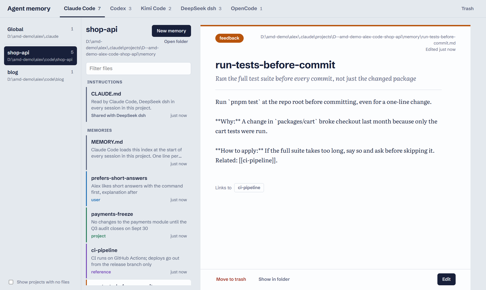
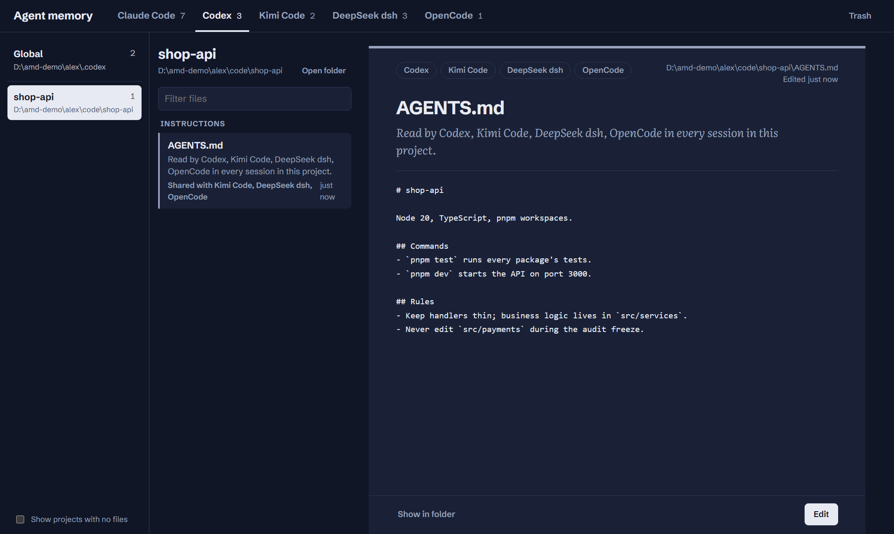

# Agent Memory Desk

One local web page to read and edit what your coding agents remember: the memory and instruction files of **Claude Code, Codex, Kimi Code, DeepSeek dsh and OpenCode**, across every project on your machine.





<sub>Screenshots use made-up sample data. The page follows your system's light or dark setting.</sub>

- **Agent first.** Pick an agent in the top bar, then its global files or one of its projects.
- **Read, then edit.** Files open read-only; press **Edit** to change them. Saving rewrites only what you changed.
- **Shared files are marked.** `AGENTS.md` is read by several agents, so the page tells you who else will see an edit.
- **A real trash bin.** Deleted memories go to one trash folder and can be restored to where they came from.
- **Local and dependency-free.** Plain Node.js, no packages, no build step, no account. The page only listens on `127.0.0.1`.

## Requirements

- Node.js 18 or newer (`node --version`)
- Windows, macOS or Linux

## Quick start

Run it once, without installing anything:

```bash
npx github:Lilb1tty/agent-memory-desk start
```

Then open http://localhost:7717. Press Ctrl+C in the terminal to stop it.

## Install

Pick one.

**Global command** (recommended):

```bash
npm install -g github:Lilb1tty/agent-memory-desk
agent-memory-desk install
```

**From a clone**, if you want to read or change the code:

```bash
git clone https://github.com/Lilb1tty/agent-memory-desk.git
cd agent-memory-desk
node bin/agent-memory-desk.js install
```

`install` makes the desk start every time you log in, and starts it right away.

## Commands

```
agent-memory-desk <command> [options]
```

| Command | What it does |
|---|---|
| `start` | Run the desk in this terminal (Ctrl+C to stop) |
| `install` | Start the desk at login, and start it now |
| `uninstall` | Stop starting at login, and stop the running desk |
| `stop` | Stop the running desk |
| `status` | Show whether it is installed and running |
| `open` | Open the desk in your browser |

| Option | Meaning |
|---|---|
| `--port <n>` | Port to use. Default `7717`. |
| `--trash <dir>` | Folder for trashed memories. Default: `trash/` in the app folder. |
| `--dry-run` | With `install` or `uninstall`: print what would change, change nothing. |

Examples:

```bash
agent-memory-desk install --port 7800 --trash ~/agent-trash
agent-memory-desk status
agent-memory-desk install --dry-run
```

`stop`, `status`, `open` and `uninstall` use the port you installed with, so you don't need to repeat `--port`.

### How start-at-login works

`install` writes one file, and `uninstall` deletes it. Nothing else changes on your system.

| System | File |
|---|---|
| Windows | `%APPDATA%\Microsoft\Windows\Start Menu\Programs\Startup\agent-memory-desk.vbs` (starts Node with no console window) |
| macOS | `~/Library/LaunchAgents/com.agent-memory-desk.plist` (launchd; log in `~/Library/Logs/agent-memory-desk.log`) |
| Linux | `~/.config/systemd/user/agent-memory-desk.service` (systemd user service; log via `journalctl --user -u agent-memory-desk`) |

The file records the full path to `node` and to the app. If you move the app folder or switch Node versions, run `install` again.

## Using the page

1. **Pick an agent** in the top bar. The number is how many files it has.
2. **Pick a place** in the left column: **Global** (files that apply to every project) or a project. Only projects where that agent has files are listed; tick *Show projects with no files* to see every project it has been used in.
3. **Pick a file** in the middle column. It opens read-only.
4. **Edit** unlocks it. **Save** (or Ctrl+S / Cmd+S) writes it; **Cancel** throws the changes away.

The address bar always points at the open file (`#agent/place/file`), so you can bookmark a memory.

Other controls:

- **Open folder** opens the folder the files live in. For Claude Code projects that is the memory folder under `~/.claude/projects/`, not the project itself.
- **Show in folder** opens your file manager with the current file selected.
- **New memory** (Claude Code projects) creates a memory and adds it to `MEMORY.md`.
- **Move to trash** (Claude Code memories and rules) moves the file to the trash and removes its line from `MEMORY.md`.
- **Edit raw file** shows a Claude Code memory as plain text, header included.
- Files marked **Not created yet** are global files an agent would read if they existed; saving one creates it.

Claude Code memories show their name, description and type (`user`, `feedback`, `project`, `reference`) as separate fields. Header keys the page does not know about are kept as they are.

## Trash

Click **Trash** in the top bar to see everything that was moved there.

- **Restore** puts the file back where it came from, and re-adds its `MEMORY.md` line for Claude Code memories. If a file with that name already exists there, nothing is overwritten.
- **Delete forever** removes one file for good. **Empty trash** removes all of them. Both ask first.

The trash is one folder for every agent and project. By default it is `trash/` inside the app folder, so it's easy to find. Each trashed file has a small `.json` note beside it that records where it came from. The folder is listed in `.gitignore`, so trashed memories never end up in a commit.

## Which files it reads

**Global** (apply to every project):

| Agent | Files |
|---|---|
| Claude Code | `~/.claude/CLAUDE.md`, `~/.claude/rules/*.md` |
| Codex | `~/.codex/AGENTS.md`, `~/.codex/AGENTS.override.md`, `~/.codex/memories/MEMORY.md`, `memory_summary.md`, `raw_memories.md` |
| Kimi Code | `~/.kimi-code/AGENTS.md`, `~/.agents/AGENTS.md` |
| DeepSeek dsh | `~/.dsh/AGENTS.md` |
| OpenCode | `~/.config/opencode/AGENTS.md` |

**Per project:**

| Agent | Files in the project folder | Elsewhere |
|---|---|---|
| Claude Code | `CLAUDE.md`, `CLAUDE.local.md`, `.claude/CLAUDE.md` | Memories in `~/.claude/projects/<project>/memory/` |
| Codex | `AGENTS.md`, `AGENTS.override.md` | |
| Kimi Code | `AGENTS.md`, `.kimi-code/AGENTS.md` | |
| DeepSeek dsh | `AGENTS.md`, `CLAUDE.md`, `AGENTS.local.md`, `CLAUDE.local.md` | |
| OpenCode | `AGENTS.md` | |

**Where projects come from.** The desk does not search your disk. It lists the projects each agent has recorded:

| Agent | Source |
|---|---|
| Claude Code | `~/.claude/projects/*` (the real path is read from the session logs) |
| Codex | `[projects."…"]` entries in `~/.codex/config.toml` |
| Kimi Code | `~/.kimi-code/workspaces.json` |
| DeepSeek dsh | `~/.dsh/storages/workspace.json` |
| OpenCode | `~/.local/share/opencode/storage/project/*.json` |

The same folder seen by several agents shows up once per agent, pointing at the same files.

An agent's tab only appears when its home folder exists. Codex memories are written by Codex itself, so Codex may rewrite them later.

## Settings

All optional.

| Setting | Effect |
|---|---|
| `--port`, or `PORT` | Port to listen on (default `7717`) |
| `--trash`, or `AGENT_MEMORY_TRASH` | Trash folder |
| `CLAUDE_CONFIG_DIR` | Claude Code home instead of `~/.claude` |
| `CODEX_HOME` | Codex home instead of `~/.codex` |
| `DSH_HOME` | dsh home instead of `~/.dsh` |
| `XDG_CONFIG_HOME`, `XDG_DATA_HOME` | Base folders for OpenCode |
| `AGENT_MEMORY_HOME` | Pretend this folder is your home folder (handy for trying it on a copy) |

## Safety

The desk edits files in your home folder, so it is deliberately narrow:

- It listens on `127.0.0.1` only and rejects requests whose `Host` or `Origin` is not the desk itself. Other websites can't read or change your files through it.
- It only writes files it found itself. The page can't name an arbitrary path.
- Deleting always goes to the trash first.
- The page runs under a strict Content Security Policy: no inline code, no third-party scripts. The only outside requests are Google Fonts; without a connection it falls back to system fonts.
- It has no dependencies, so there is no third-party code to audit.

## Project layout

```
bin/agent-memory-desk.js   the command line
server.js                  local web server and API
lib/scan.js                finds each agent's files and projects
lib/autostart.js           start-at-login for Windows, macOS and Linux
public/                    the page: index.html, app.css, app.js
```

To work on it, run `node bin/agent-memory-desk.js start` and reload the page after each change. The page needs no build step; restart the command after changing server code.

## Adding another agent

Add an entry to `HARNESSES` in `lib/scan.js` with its home folder, global files and project file names. If it records its projects somewhere, add a reader next to `kimiProjects` and include it in `sources`.

## License

MIT
